# Python Power Quality Disturbance Signal Classification (VI) - Super-strong Machine Learning Recognition Model Based on Disturbance Signal Feature Extraction

The family set includes the following content:
Includes a complete dataset of power quality disturbance signals, as well as a fully generated and prepared dataset of ten types of disturbance signals, classified data, and label sets, all of which can be run.
Includes code for data preprocessing, feature extraction and classification using XGBoost.
Environment: Python 3.9
Highly innovative!!! Students needing to submit papers can use it immediately.
Preface
This paper is based on the power quality disturbance signal simulated by Python, which first undergoes data preprocessing to create and load the dataset. Subsequently, disturbance signal recognition is conducted through feature extraction and machine learning methods. Feature extraction involves extracting meaningful features from the original PQD signals to reduce data dimensions and capture key information of the signals. Machine learning methods can establish models based on these features and identify different disturbance signals through training and learning.
The detailed introduction of Python simulations for disturbance signals in power quality can be found in the following text (end of the article is attached with a 10-category dataset):
\tPython - Data Introduction and Classification of Electric Power Quality Disturbance Signals
The waveform diagram of some disturbed signal types is as follows:
1. Dataset and feature extraction
1.1 Dataset Import
A disturbance signal model is constructed based on the IEEE Std1159-2019 Power Quality Detection Standard and related literature. Ten types of single signals and various composite disturbance signals are generated, including normal signals. Preprocessing for the 10-class classification of disturbance signals is conducted in reference to previous articles.
Step 1: Generate a single signal according to the formula model.
\t  
Single disturbance signal visualization:
\tCreate a dataset based on a signal time step of 1024.
Form 5000 samples, each with a length of 1024, plus one label category.
1.2 Feature Extraction of Disturbance Signal
(1) Kurtosis: Measures the sharpness of a signal, used to detect high-frequency components in signals.
(2) Entropy: A measure of the complexity and randomness of a signal, used to detect its spectral characteristics.
(3) Fractal Dimension: Measuring the self-similarity and complexity of signals, used for analyzing the fractal characteristics of signals.
(4) Waveform Indicators: Including peak factor, impulse factor, margin factor, etc., used to analyze the time-domain characteristics of signals.
(5) Spectral Indicators: Includes peak frequency, energy ratio, spectral line indicators, etc., used for analyzing the frequency domain characteristics of signals.
(6) Frequency Domain Indicators (Time-Frequency Indicators): Including instantaneous frequency, instantaneous energy, etc., used for analyzing the time-frequency characteristics of signals.
(7) Statistical Features (Statistical Features): Including mean, variance, skewness, etc., used to describe the statistical characteristics of signals.
(8) Wavelet Packet Features: Features extracted through wavelet transformation, used for analyzing the time-frequency local characteristics of signals.
(9) Vibration Characteristics (Vibration Features): Including peak vibration and effective value vibration, used to describe the vibration characteristics of signals.
Various feature extraction methods were selected to capture different characteristics of the signal, resulting in a total of 13 features indicators across 9 categories for training and recognition of machine learning models.
2. Strong Model XGBoost - Principles Introduction
2.1 Principle Introduction
\tPaper link: \t
XGBoost | Proceedings of the 22nd ACM SIGKDD International Conference on Knowledge Discovery and Data Mining

The GBoost model (Extreme Gradient Boosting) is a gradient boosting framework developed by Tianqi Chen in 2014, widely applied in the field of machine learning. The core idea of XGBoost is to iteratively train multiple weak learners and combine them to achieve powerful predictive capabilities. It improves and optimizes the gradient boosting algorithm, characterized by efficiency, flexibility, and scalability.

Here are some key features and principles of XGBoost:

1. Gradient Boosting: XGBoost employs the gradient boosting algorithm, also known as the Boosting algorithm. It iteratively trains multiple weak learners and optimizes the model's predictive capability through gradient descent. Each weak learner is trained on the residual of the previous weak learner, gradually reducing prediction errors.

2. Tree-based Model: XGBoost adopts a tree-based model, namely decision trees. Decision trees are very flexible and interpretable models that can learn complex nonlinear relationships. XGBoost uses CART (Classification and Regression Trees) as the default base learner, where each decision tree is implemented through continuous feature space partitioning for classification or regression tasks.

3. Regularization Strategy: To prevent overfitting, XGBoost introduces regularization strategies. It limits the model's learning ability by controlling the complexity of the decision trees. Common regularization strategies include limiting the maximum depth of the decision trees, setting the minimum sample count for leaf nodes, and weight decay for leaf node weights.
4. Feature selection and splitting: XGBoost maximizes the model's gain by feature selection and splitting during the construction of decision trees. Feature selection is based on some evaluation criteria (such as information gain or Gini coefficient), selecting the most advantageous features for the current node's partitioning. Feature splitting is the process of determining the points where features are divided, ensuring that the sub-nodes after partitioning can minimize prediction errors to the greatest extent.
5. Parallel computing: To improve the speed of model training, XGBoost employs a strategy of parallel computing. It decomposes the training task into multiple subtasks through multithreading and distributed computing technologies, and computes simultaneously on different processors. This accelerates the training speed of models, especially when dealing with large-scale datasets.
6. Custom loss functions: XGBoost allows users to customize loss functions to suit different tasks and requirements. Users can define loss functions suitable for their specific problem characteristics and use them during model training.
XGBoost models have achieved good results in many machine learning tasks through gradient boosting algorithms and tree-based models, including classification, regression, ranking, and recommendation. By leveraging its efficient, flexible, and scalable features, we use XGBoost to build a gradient boosting model for bearing fault identification through iteratively training multiple decision trees.
2.2 Feature dataset preparation
3. Model evaluation and comparison
3.1 Random Forest Classification Model
Model scores, accuracy, precision, recall, F1 Score
Perturbed signal ten-class confusion matrix
3.2 Support Vector Machine (SVM) Classification Model
Model scores, accuracy, precision, recall, F1 Score
Perturbed signal ten-class confusion matrix:
3.3 XGBoost Classification Model
Model scores, accuracy, precision, recall, F1 Score
Perturbed signal ten-class confusion matrix:
The experimental results show that the various features extracted have a certain contribution to the identification of power quality disturbance signals. Skewness, entropy, and fractal values can help capture the sharpness, complexity, and self-similarity of signals, thereby effectively distinguishing different types of disturbance signals. Waveform indicators, spectral indicators, and frequency domain indicators can provide time-domain and frequency-domain characteristics of signals, aiding in the recognition of time-frequency characteristics of disturbance signals. Statistical features, wavelet packet features, and vibration features can describe the statistical and vibrational characteristics of signals, thus better distinguishing disturbance signals.
Comparatively, the XGBoost classification model performed best, with the highest model score on both training and testing sets, achieving good results in the identification of disturbance signals. By accurately capturing the features and patterns of signals, it is capable of accurately identifying and classifying different types and degrees of signal types, achieving an accuracy rate of 98%. The model is fast, performs well, and has high innovation.

## Images

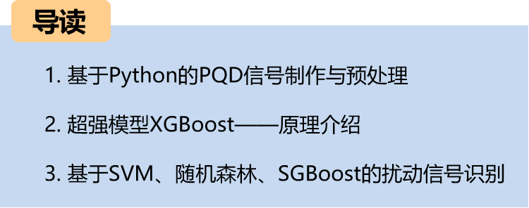

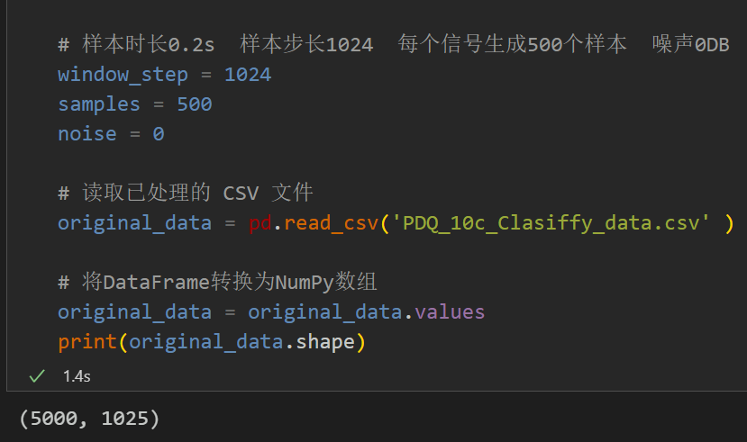
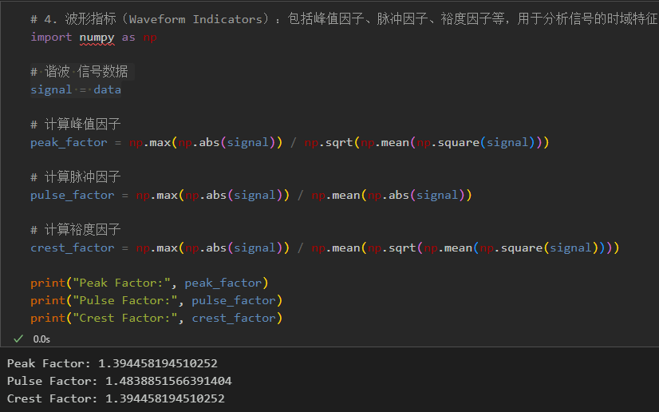
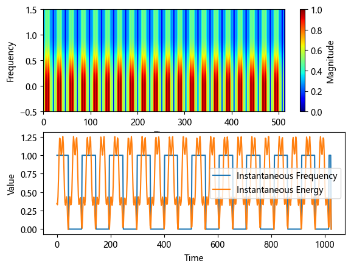
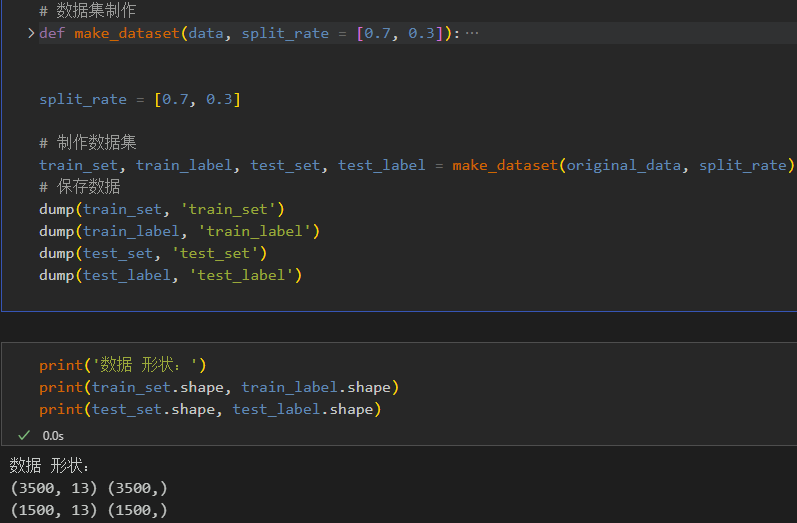
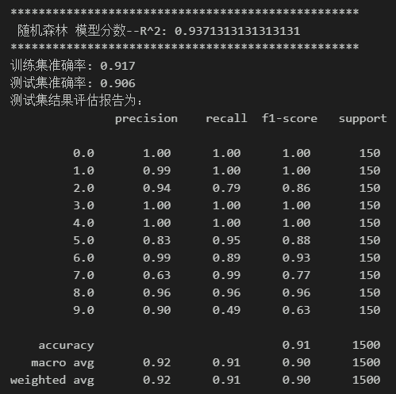
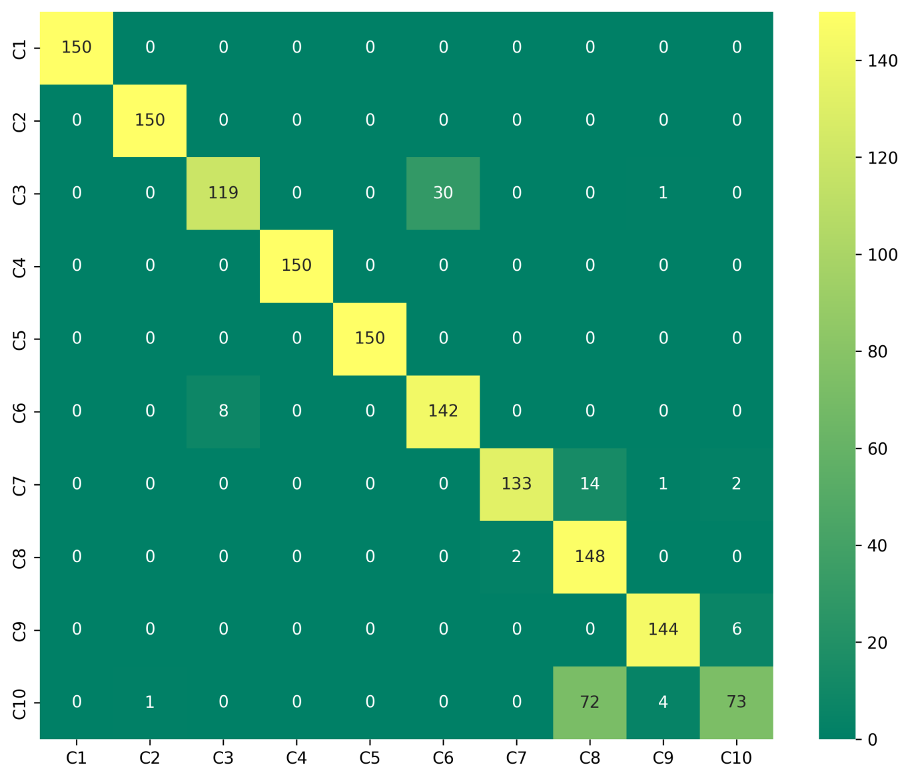

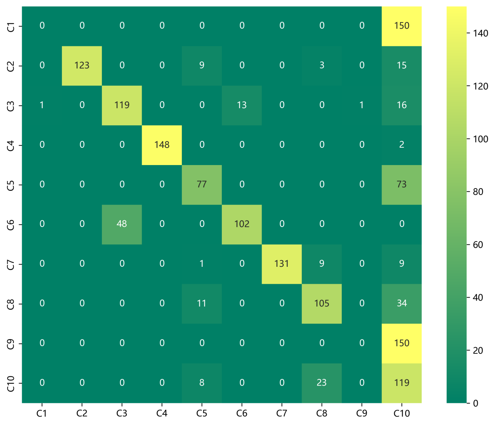
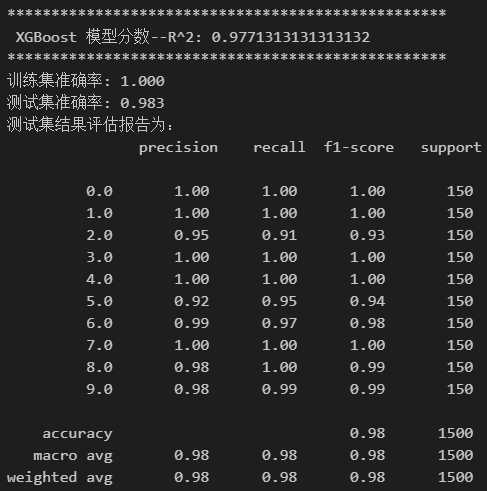
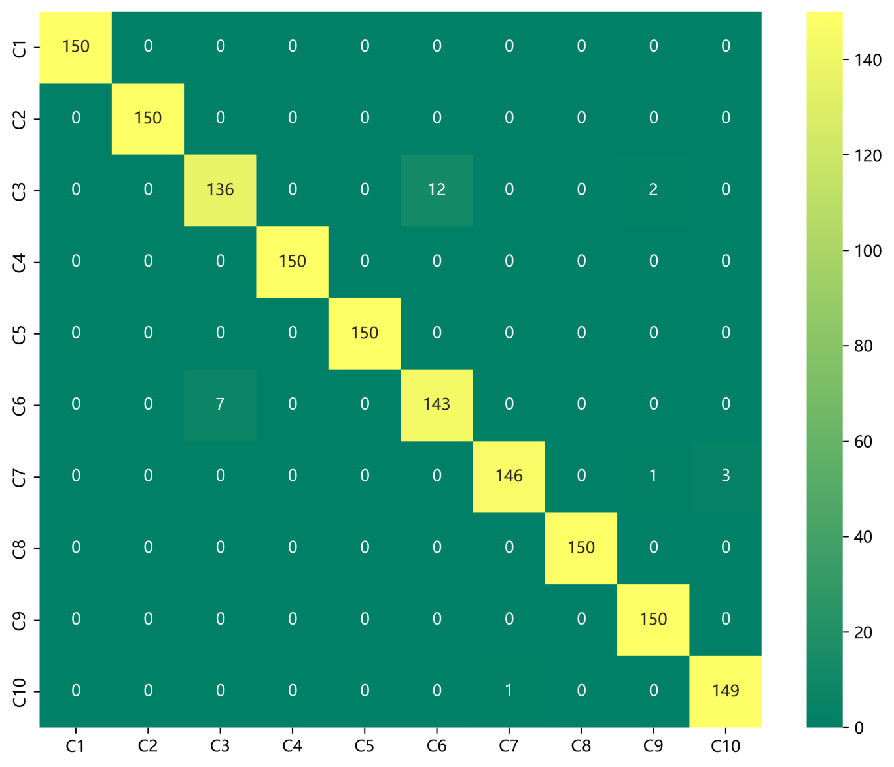
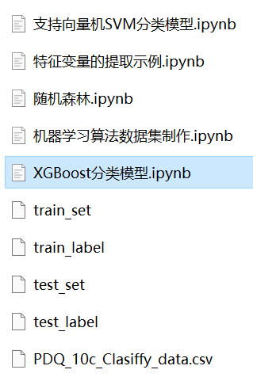

<!-- PAYMENT_BLOCK -->

## Get this dataset

- Payment link (Stripe): [Buy now](https://buy.stripe.com/3cs8yP7sY87d0vu9AB)
- Payment QR code: 

<!-- /PAYMENT_BLOCK -->
